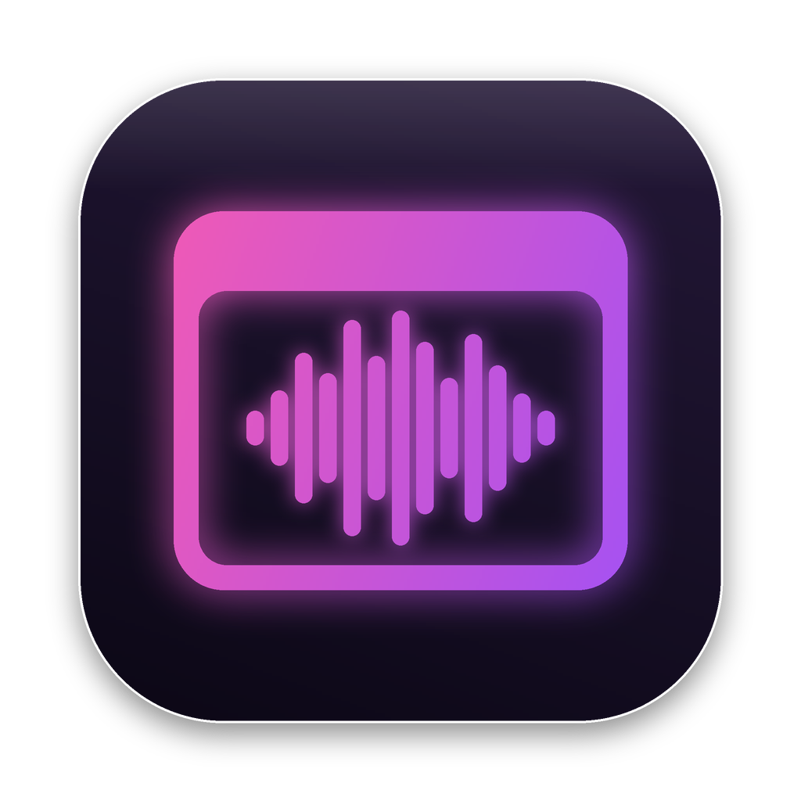

<p align="center">
  
</p>

<h1 align="center">AppChime</h1>

<p align="center">
  앱이 켜지거나 꺼질 때 원하는 소리를 재생하는 작은 프로그램<br>
  macOS · Windows
</p>

<p align="center">
  <a href="https://github.com/ixia00/appchime/releases/latest"><b>⬇ 다운로드</b></a>
</p>

> **EN** — AppChime plays a sound of your choice when an app launches or quits. Free, for macOS and Windows.
> **JA** — AppChime は、アプリの起動時・終了時に好きなサウンドを再生する macOS / Windows 用の無料ツールです。

---

## 이런 걸 할 수 있어요

- **앱마다 다른 소리**: 보컬로이드 에디터엔 이 목소리, 그림 프로그램엔 저 효과음
- **켜질 때 / 꺼질 때**를 따로 켜고 끄고, 소리도 따로 지정
- **메인 창이 뜰 때 재생**: 로딩 화면 말고, 실제 작업 화면이 나타나는 순간에 재생
- 소리 여러 개 등록 후 **고정 / 무작위 / 순서대로** 재생
- 앱별 볼륨, 미리듣기, 파일 끌어다 놓기
- 메뉴 막대(트레이)에서 **전체 소리 켜기/끄기**, 원하면 단축키 지정
- 시스템 시작 시 자동 실행, 다크 모드, 강조 색상
- 한국어 · English · 日本語

평소엔 메뉴 막대(맥) / 트레이(윈도우)에 작은 아이콘으로만 있고, 바탕화면이나 Dock·작업 표시줄엔 나타나지 않아요.

지원하는 소리 파일: `mp3` `wav` `ogg` `flac` `m4a` `aac` (파일당 최대 50MB)

---

## 설치

[Releases](https://github.com/ixia00/appchime/releases/latest) 페이지 아래 **Assets**에서 받으세요.

| 컴퓨터 | 받을 파일 |
|---|---|
| Mac (M1·M2·M3 등 Apple 칩) | `AppChime_x.x.x_aarch64.dmg` |
| Mac (인텔) | `AppChime_x.x.x_x64.dmg` |
| Windows 10 / 11 | `AppChime_x.x.x_x64-setup.exe` |

> AppChime은 개인이 만든 무료 프로그램이라 유료 개발자 서명이 없어요. 그래서 처음 설치할 때 경고가 뜨는데, 아래 방법대로 하면 정상적으로 쓸 수 있어요.

### Mac

1. `.dmg`를 열고 **AppChime을 응용 프로그램 폴더로 끌어다 놓기**
   (dmg 창에서 바로 실행해도 알아서 응용 프로그램 폴더로 옮겨진 뒤 다시 켜져요)
2. 응용 프로그램 폴더에서 AppChime을 **오른쪽 클릭 → 열기 → 열기**
   - "확인되지 않은 개발자" 경고 때문에 열기 버튼이 없으면:
     **시스템 설정 → 개인정보 보호 및 보안** → 아래쪽 "AppChime이(가) 차단되었습니다" 옆 **그래도 열기**
3. 화면 위쪽 메뉴 막대에 🔊 아이콘이 생기면 성공
4. **손쉬운 사용 권한 켜기** (메인 창 감지에 필요)
   설정 창에서 **권한 허용**을 누르거나, **시스템 설정 → 개인정보 보호 및 보안 → 손쉬운 사용**에서 AppChime 켜기

### Windows

1. 다운로드할 때 브라우저가 경고하면
   - Edge: 다운로드 목록에서 `…` → **유지** → **자세히 표시** → **그래도 유지**
   - Chrome: **유지** → **그래도 다운로드**
2. 설치 파일 실행 → "Windows의 PC 보호" 창이 뜨면 **추가 정보 → 실행**
3. 설치가 끝나면 시계 옆 **`^`(숨겨진 아이콘)** 안에 🔊 아이콘이 생겨요
   - 아이콘을 작업 표시줄로 끌어다 놓으면 항상 보여요

---

## 사용법

1. 메뉴 막대 / 트레이의 🔊 아이콘 → **설정 열기…**
2. **앱 추가** → 실행 중인 앱이나 설치된 앱에서 고르기 (목록에 없으면 **직접 선택…**)
3. **실행 시 소리 재생** 카드에서 **소리 파일 추가** (파일을 카드 위로 끌어다 놓아도 돼요)
4. 재생 방식, 재생 시점, 볼륨 정하기
5. 끝! 창을 닫아도 AppChime은 계속 켜져 있어요

**재생 시점**
- **메인 창 표시 시** (기본): 로딩 화면이 지나고 실제 창이 뜰 때 재생
- **실행 즉시**: 아이콘을 누르자마자 재생
- 로딩 화면에서 소리가 먼저 나는 앱이면 **추가 지연**을 1~3초 정도 주세요

**전체 소리 끄기**: 🔊 아이콘 → **소리 켜짐** 체크 해제. 회의나 방송 중에 편해요.

---

## 자주 묻는 질문

**소리가 실행하자마자 나요 (창이 뜰 때가 아니라)**
맥이라면 손쉬운 사용 권한이 꺼져 있을 가능성이 커요. 권한이 없으면 창을 확인할 수 없어서 실행 즉시 재생해요. 설치 4단계를 확인해 주세요.

**컴퓨터를 켰는데 자동으로 안 켜져요**
- 맥: **시스템 설정 → 일반 → 로그인 항목 및 확장 프로그램**의 "백그라운드에서 허용"에서 AppChime이 켜져 있는지 확인
- 윈도우: 윈도우가 시작 프로그램을 일부러 몇 초~몇십 초 늦게 켜요. 잠깐 기다린 뒤 `^` 안을 확인해 보세요. 그래도 없으면 작업 관리자(`Ctrl + Shift + Esc`) → **시작 앱**에서 AppChime이 **사용**인지 확인
- 그래도 안 되면 AppChime 일반 설정에서 **시스템 시작 시 자동 실행**을 껐다가 다시 켜 주세요

**앱 추가 목록에 쓰려는 앱이 없어요**
**직접 선택…**을 눌러 앱(맥은 `.app`, 윈도우는 `.exe`)을 골라 주세요.

**소리 파일 이름이 깨져서 보여요 (압축 파일)**
맥 Finder나 윈도우 기본 기능으로 일본어·한자 이름이 들어간 압축을 풀면 이름이 깨질 수 있어요. [반디집](https://www.bandisoft.com/bandizip/)으로 열어 보세요.

**추가한 소리 파일 원본을 지워도 되나요?**
네. AppChime은 추가한 파일을 자기 폴더에 복사해 두기 때문에, 원본을 옮기거나 지워도 계속 재생돼요.

**AppChime을 완전히 지우고 싶어요**
1. 🔊 아이콘 → **AppChime 종료**
2. 맥: 응용 프로그램 폴더에서 AppChime 삭제 / 윈도우: 설정 → 앱 → AppChime 제거
3. 설정과 소리 파일까지 지우려면 아래 폴더도 삭제
   - 맥: `~/Library/Application Support/com.ixia00.appchime`
   - 윈도우: `%APPDATA%\com.ixia00.appchime`

**업데이트는 어떻게 하나요?**
AppChime을 종료한 뒤 새 버전을 설치하면 돼요. 등록한 앱과 소리 설정은 그대로 남아요.

---

## 개발

[Tauri 2](https://tauri.app) (Rust) + React (TypeScript)

​```bash
npm install
npm run app:dev
​`````

### 메모
- 앱 감지는 1초 간격으로 프로세스 목록을 비교해요 (이름·경로만 읽어서 가벼워요)
- 메인 창 감지: 맥은 손쉬운 사용 API로 "표준 창" 여부, 윈도우는 제목 표시줄이 있는 최상위 창 여부로 판단해요
- 개발 모드에서는 자동 실행 등록, dmg 이동, 우클릭 메뉴 차단이 꺼져 있어요
